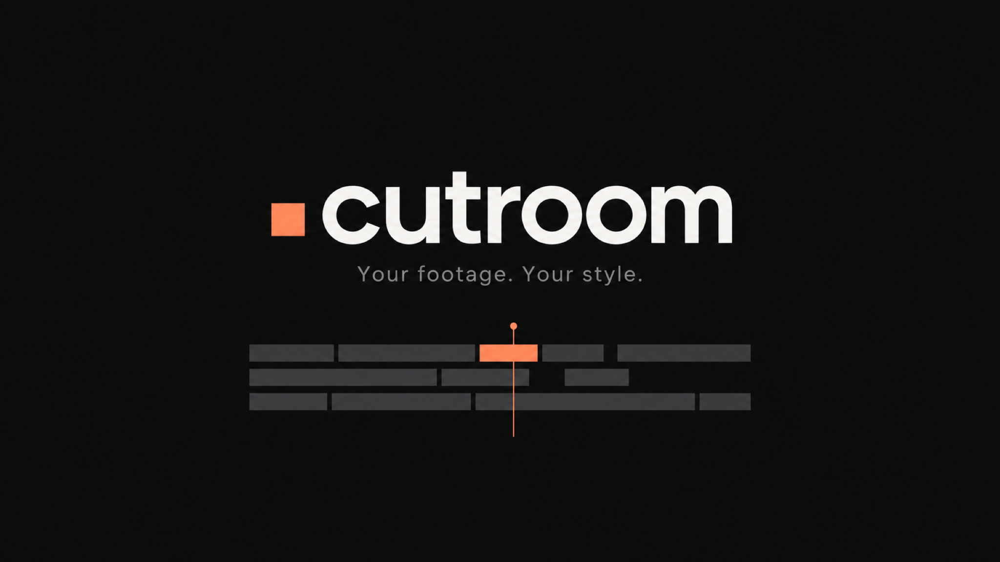

# cutroom



**Turn Claude Code and Codex into your video editor.** Drop in raw clips and say "edit these". cutroom transcribes
them, cuts the dead ends and long pauses, cleans your voice, and adds captions, motion graphics, punch-ins and sound
effects in **your** style. It renders a ready-to-post MP4.

The first time, it interviews you about your editing style: colours, fonts, captions, graphics, sound, pacing, and
the creators whose editing you love. It saves your answers as a style profile. After that it never asks again; it
just edits. Every correction you make ("that sound is annoying", "captions bigger") goes into the profile, so the
next video starts closer to right.

## What it does

| Step | How |
|---|---|
| Learns your style once | A short interview (about 5 rounds) → `~/.cutroom/style.md`, or one profile per brand if you edit for several |
| Studies your references | Paste links to videos you like. It measures their cut rate, hook, caption style and graphics, and keeps the grammar, never the content |
| Transcribes | Local Whisper **large-v3-turbo** (faster-whisper) with word timestamps and your vocabulary (names, brands, tools) |
| Cuts | Orders the clips, trims dead heads and tails, tightens pauses, removes retakes and false starts, punches in on jump cuts |
| Fixes the footage | Leaves SDR untouched; tone-maps iPhone HDR so skin looks natural |
| Cleans the voice | Denoise, de-mud, presence, de-ess and compression, then −14 LUFS |
| Motion graphics | Captions in your style, kinetic type, counters, checklists, UI mockups, split layouts, all on springs and timed to your words |
| Sound | Synthesized whooshes, pops and clicks (only the ones you like), optional ducked music |
| Reviews itself | Contact sheets at phone size, safe-zone checks and a scoring loop, before you see anything |
| Renders | H.264 MP4 at 9:16, 16:9, 1:1 or 4:5 |

## Install

Use macOS 13+ or Linux (Windows: use WSL), Python 3.10–3.13, Node.js 20/22/24 with npm,
and FFmpeg 6+ with H.264/AAC support. Setup checks your machine and installs the private editing runtime.

```bash
git clone https://github.com/statiiiix/cutroom.git
cd cutroom
sh install.sh
```

Add `--install-system-tools` to install missing prerequisites with Homebrew or apt.

It installs:
- a private Python env at `~/.cutroom/venv` with an exact dependency set for faster-whisper, numpy and yt-dlp
- the Whisper large-v3-turbo model (about 1.6 GB, once)
- locked Playwright packages at `~/.cutroom/node` and matching headless Chromium at `~/.cutroom/browsers`
- the self-contained skill for **Claude Code** (`~/.claude/skills/cutroom`) and **Codex** (`~/.codex/skills/cutroom`)

Options: `--claude` or `--codex` (one agent only), `--project <dir>` (one project only), `--no-model` (download Whisper
on first use instead). On Linux, `--with-system-deps` installs Chromium's required system libraries.
Preview the installation without changing anything with `sh install.sh --dry-run`.

Check your setup any time:

```bash
sh ~/.codex/skills/cutroom/scripts/cutroom doctor
```

An installed skill carries its own setup tools; the original checkout is not needed for maintenance:

```sh
sh ~/.codex/skills/cutroom/scripts/cutroom version
sh ~/.codex/skills/cutroom/scripts/cutroom update --no-model
sh ~/.codex/skills/cutroom/scripts/cutroom repair --no-model
sh ~/.codex/skills/cutroom/scripts/cutroom uninstall --dry-run
```

See [setup and maintenance](skills/cutroom/references/setup.md) for official repository updates, checked local packages,
custom runtime locations, project installs, and removal that preserves profiles and projects.

## Use

Start a new Claude Code or Codex session (skills load at startup), then:

```
/cutroom edit ~/Desktop/IMG_1234.MOV ~/Desktop/IMG_1235.MOV
```

You don't have to type `/cutroom`. "Edit these clips into a reel" with files attached works too.

The first run interviews you. After that, a typical edit goes:
1. it shows you the transcript to check names and words
2. it shows a short shotlist of the graphics, if you asked to approve those
3. it reviews its own draft, then renders `renders/final.mp4`

Change your style any time: "change my caption style", "stop using music", "my accent colour is now #00C2FF".

## Save an editing style you like

When you approve an edit, cutroom can ask whether you want to save its editing style. Say yes and give it a name,
such as “Clean explainer.” It saves creative notes, typography, colors, caption treatment, pacing, sound settings
and optional approved reference frames. Your onboarding and profile memory continue as before.

For a later video, say “Use my Clean explainer style.” Cutroom studies that direction and designs graphics for the
new video's footage and words. Saving a style is optional and does not set a new default.

See [saved styles](skills/cutroom/references/saved-styles.md) for capture and selection commands. The
[layout guide](skills/cutroom/references/layouts.md) supplies geometry for talking heads, tutorials and two speakers
across all four aspect ratios; each scene's design is created for its own video.

## Faster revisions

After the transcript and cut are approved, the build command tracks completed work and reuses unchanged outputs:

```sh
sh ~/.codex/skills/cutroom/scripts/cutroom status --project videos/example
sh ~/.codex/skills/cutroom/scripts/cutroom build --project videos/example --draft
sh ~/.codex/skills/cutroom/scripts/cutroom build --project videos/example
```

Caption and graphic changes reuse the cut and audio. Music and sound-effect changes reuse the rendered picture.
Cut revisions remap word timings while retaining confirmed text corrections. Unchanged transcription inputs reuse
their transcript. Interrupted builds resume from successful stages. The [build guide](skills/cutroom/references/build.md)
describes status, force rebuilds, manual commands and draft/final outputs.

## Your style profile

`~/.cutroom/style.md` is a plain Markdown file with a JSON settings block. Read it, edit it, share it, or keep one per
brand in `~/.cutroom/profiles/`. The **Feedback log** at the bottom is where cutroom records every correction you've
made.

## Repo layout

```
install.sh                    one-command setup for Claude Code + Codex
skills/cutroom/SKILL.md       the workflow the agent follows
skills/cutroom/references/    onboarding interview, reference study, editing, graphics, review
skills/cutroom/engine/        the frame-exact motion engine (runtime.js) + film template
skills/cutroom/setup/         bundled installer, pinned dependencies, version and lifecycle manager
skills/cutroom/scripts/       editing scripts, incremental build/status, setup/maintenance and diagnostics
skills/cutroom/templates/     the style profile template
```

## How the graphics render

Each video is a small web page whose `seek(t)` paints frame t: footage frames underneath, and HTML/SVG graphics
on top, animated with closed-form springs. Headless Chromium captures every frame and ffmpeg encodes it. No
timers, no randomness, no 3D layers, so a frame always renders the same, and you can render any single moment for a
quick check.

## License

MIT
