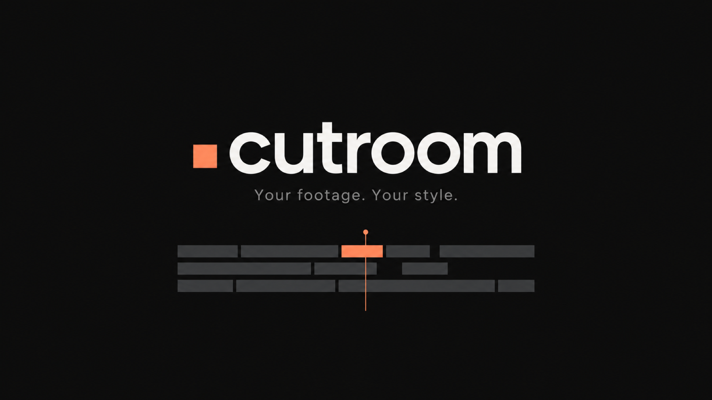

# cutroom



**Turn Claude Code and Codex into your video editor.** Drop in raw clips and say "edit these". cutroom transcribes
them, cuts the dead ends and long pauses, cleans your voice, and adds captions, punch-ins, sound effects and **motion
graphics that explain what you're saying**, all in **your** style. It renders a ready-to-post MP4.

The first time, it interviews you about your editing style: colours, fonts, captions, graphics, sound, pacing, and
the creators whose editing you love. It saves your answers as a style profile. After that it never asks again; it
just edits. Every correction you make ("that sound is annoying", "captions bigger") goes into the profile, so the
next video starts closer to right.

## What it does

| Step | How |
|---|---|
| Learns your style once | A short interview (about 5 rounds) → `~/.cutroom/style.md`, or one profile per brand if you edit for several |
| Studies your references | Paste links to videos you like. It measures their cut rate, hook, caption style and graphics, and keeps the grammar, never the content |
| Transcribes | Local Whisper **large-v3-turbo** (faster-whisper) with word timestamps and your vocabulary (names, brands, tools) |
| Cuts | Orders the clips, trims dead heads and tails, tightens pauses, removes retakes and false starts, punches in on jump cuts |
| Fixes the footage | Leaves SDR untouched; tone-maps iPhone HDR so skin looks natural |
| Cleans the voice | Denoise, de-mud, presence, de-ess and compression, then −14 LUFS |
| Explains with motion graphics | Reads your transcript and illustrates each beat: counters, checklists, logos, UI mockups, kinetic type and split layouts, all on springs and timed to your words ([more below](#motion-graphics-that-explain-what-you-say)) |
| Sound | Synthesized whooshes, pops and clicks (only the ones you like), optional ducked music |
| Reviews itself | Contact sheets at phone size, safe-zone checks and a scoring loop, before you see anything |
| Renders | H.264 MP4 at 9:16, 16:9, 1:1 or 4:5 |

## Motion graphics that explain what you say

Captions show your words. The graphics show what you mean. cutroom reads the transcript and picks a graphic for each
beat, then times it so it lands on the word:

| You say… | It shows |
|---|---|
| a number, time or price ("it saves me 3 hours") | a counter that rolls to the value and lands on the word |
| a list ("cuts, captions and sound") | checklist rows that tick in on each word |
| a tool, app or brand | its logo and name chip in its own colours, or a small faithful UI panel |
| a process ("drag it in and it does the rest") | a mini UI scene: a cursor drags a file in, rows tick |
| a contrast ("instead of hiring an editor") | the old way on a card that gets struck through |
| a before and after | a split screen with labels and a wipe between them |
| a bold claim | big kinetic type with the key word in your accent and a punch-in |

The shot re-blocks around the graphic: you slide aside into a split layout, or your footage shrinks into a card to make room. Patterns vary
so the same one never runs three times in a row. Everything moves on closed-form springs, with no fades as
transitions and no glow, and is checked on phone-size contact sheets before you see it. Ask for more or fewer any
time: "add a counter when I say the price", "fewer graphics, more of my face".

## Install

Give your AI agent (Claude Code, Codex, Cursor, etc.) this repo link and ask it to install it:

```
Install this skill for me: https://github.com/statiiiix/cutroom
```

It handles the rest. Prefer to do it yourself? See [setup and maintenance](skills/cutroom/references/setup.md).

## Use

Start a new Claude Code or Codex session (skills load at startup), then:

```
/cutroom edit ~/Desktop/IMG_1234.MOV ~/Desktop/IMG_1235.MOV
```

You don't have to type `/cutroom`. "Edit these clips into a reel" with files attached works too.

The first run interviews you. After that, a typical edit goes:
1. it shows you the transcript to check names and words
2. it shows a short shotlist of the graphics, if you asked to approve those
3. it reviews its own draft, then renders `renders/final.mp4`

Change your style any time: "change my caption style", "stop using music", "my accent colour is now #00C2FF".

## Save an editing style you like

When you approve an edit, cutroom can ask whether you want to save its editing style. Say yes and give it a name,
such as “Clean explainer.” It saves creative notes, typography, colors, caption treatment, pacing, sound settings
and optional approved reference frames. Your onboarding and profile memory continue as before.

For a later video, say “Use my Clean explainer style.” Cutroom studies that direction and designs graphics for the
new video's footage and words. Saving a style is optional and does not set a new default.

See [saved styles](skills/cutroom/references/saved-styles.md) for capture and selection commands. The
[layout guide](skills/cutroom/references/layouts.md) supplies geometry for talking heads, tutorials and two speakers
across all four aspect ratios; each scene's design is created for its own video.

## Faster revisions

After the transcript and cut are approved, the build command tracks completed work and reuses unchanged outputs:

```sh
sh ~/.codex/skills/cutroom/scripts/cutroom status --project videos/example
sh ~/.codex/skills/cutroom/scripts/cutroom build --project videos/example --draft
sh ~/.codex/skills/cutroom/scripts/cutroom build --project videos/example
```

Caption and graphic changes reuse the cut and audio. Music and sound-effect changes reuse the rendered picture.
Cut revisions remap word timings while retaining confirmed text corrections. Unchanged transcription inputs reuse
their transcript. Interrupted builds resume from successful stages. The [build guide](skills/cutroom/references/build.md)
describes status, force rebuilds, manual commands and draft/final outputs.

## Your style profile

`~/.cutroom/style.md` is a plain Markdown file with a JSON settings block. Read it, edit it, share it, or keep one per
brand in `~/.cutroom/profiles/`. The **Feedback log** at the bottom is where cutroom records every correction you've
made.

## Repo layout

```
install.sh                    one-command setup for Claude Code + Codex
skills/cutroom/SKILL.md       the workflow the agent follows
skills/cutroom/references/    onboarding interview, reference study, editing, graphics, review
skills/cutroom/engine/        the frame-exact motion engine (runtime.js) + film template
skills/cutroom/setup/         bundled installer, pinned dependencies, version and lifecycle manager
skills/cutroom/scripts/       editing scripts, incremental build/status, setup/maintenance and diagnostics
skills/cutroom/templates/     the style profile template
```

## How the graphics render

Each video is a small web page whose `seek(t)` paints frame t: footage frames underneath, and HTML/SVG graphics
on top, animated with closed-form springs. Headless Chromium captures every frame and ffmpeg encodes it. No
timers, no randomness, no 3D layers, so a frame always renders the same, and you can render any single moment for a
quick check.

## License

MIT
