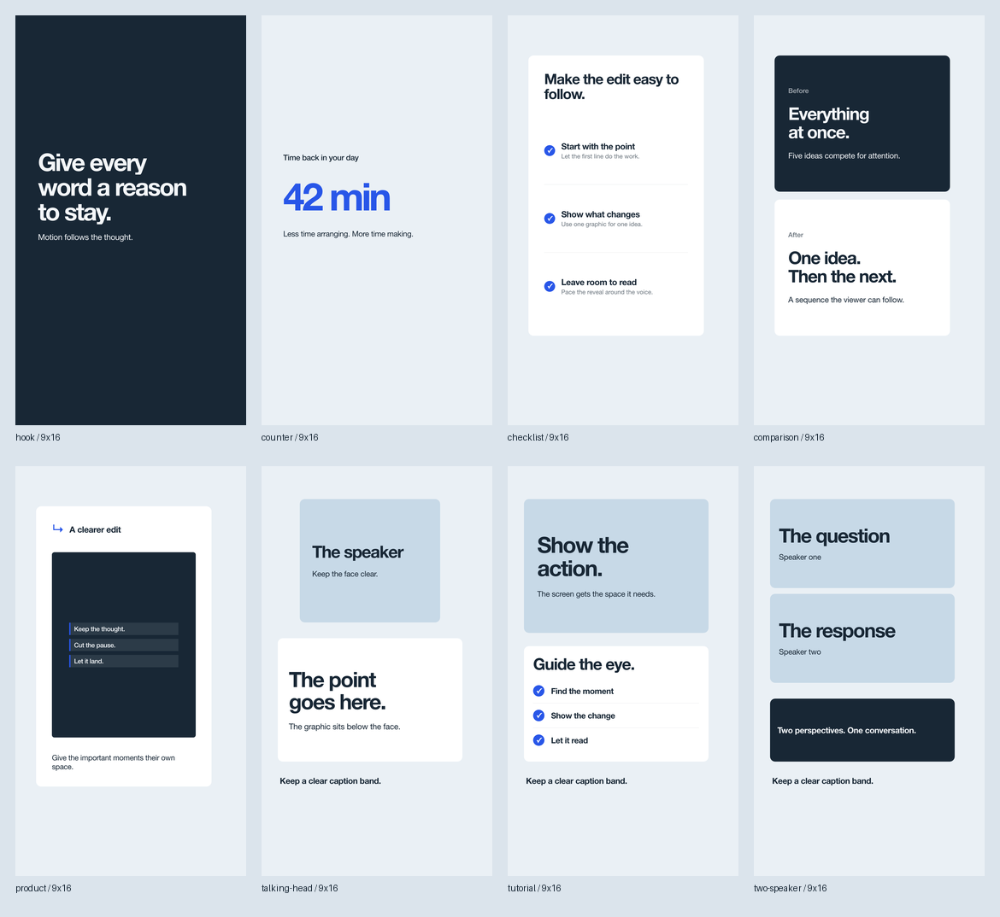

# Content-first graphics gallery

Eight short beats demonstrate the production [components](../../references/components.md) and [layouts](../../references/layouts.md). The gallery uses the same modules copied into new projects. It has no required footage, remote images, fonts, audio or profile, so it also makes a useful offline starting point for a custom visual style. The example palette belongs to this composition; it does not change a user's profile.

From the repository root (or use absolute script paths after installation):

```sh
python3 skills/cutroom/examples/gallery/create.py /tmp/cutroom-gallery --format all
node skills/cutroom/scripts/render.mjs --project /tmp/cutroom-gallery/9x16 --verify
node skills/cutroom/scripts/render.mjs --project /tmp/cutroom-gallery/9x16 --at 1.5,4.5,7.5,10.5,13.5,16.5,19.5,22.5
node skills/cutroom/scripts/render.mjs --project /tmp/cutroom-gallery/9x16 --range 0,3
node skills/cutroom/scripts/render.mjs --project /tmp/cutroom-gallery/9x16 --draft
```

`create.py <destination> --format 16x9` creates one format directly in that destination; `--format all` adds four format subdirectories. It refuses nonempty targets. On a machine using system Chrome, prefix rendering commands with `CUTROOM_CHROMIUM='/path/to/chrome'`. Run the installer first for the renderer's Playwright/FFmpeg dependencies. Stills land in `review/stills/`, the short clip in `renders/clip_0-3.mp4`, and the silent full gallery in `renders/draft.mp4`. Preview the HTML in a local web server and call `window.seek(seconds)` for manual scrubbing.

## The eight beats

All examples live in [film.js](film.js). Entry starts 0.15 s into each beat; exit starts at 2.65 s. The deliberately short gallery demonstrates a shape vocabulary, not a narration-ready reading speed. Extend holds to match the actual voice and copy. Selected stills below were captured from the production engine at the midpoint of each beat.

| Beat / settled time | Shared source API | Why it works | Rendered still |
|---|---|---|---|
| Hook / 1.5 s | `C.hook` | A direct sentence carries the opening. Line masks provide motion while the copy stays still long enough to read. | [Hook](assets/hook.png) |
| Result / 4.5 s | `C.counter` | One number earns the accent. The unit is part of the value; the supporting line explains what the quantity means. | [Counter](assets/counter.png) |
| Process / 7.5 s | `C.checklist` | Three rows form an actual sequence. Stable row geometry and staggered checks direct attention without rearranging the layout. | [Checklist](assets/checklist.png) |
| Change / 10.5 s | `C.comparison` | Two opposing structures make the contrast visible. Stacking on portrait preserves readable titles and natural reading order. | [Comparison](assets/comparison.png) |
| Product / 13.5 s | `C.product` + custom preview | The preview shows an original editing concept, not a fabricated version of a real app. The product card and preview share the normal deterministic animation path. | [Product card](assets/product.png) |
| Talking head / 16.5 s | `recipe('talking-head')` + `C.info`, `C.label` | Speaker and statement get separate space, with a caption band below. Landscape shifts the statement to the side. | [Talking head](assets/talking-head.png) |
| Tutorial / 19.5 s | `recipe('tutorial')` + `C.info`, `C.checklist`, `C.label` | The action gets the large viewport; three steps guide the eye. The layout changes orientation instead of squeezing a landscape screen beside tiny type. | [Tutorial](assets/tutorial.png) |
| Conversation / 22.5 s | `recipe('two-speaker')` + `C.info`, `C.label` | Both perspectives have equal weight. A shared statement ties them together while captions retain a clear band. | [Two speakers](assets/two-speaker.png) |

## Formats

The same source runs in `9x16`, `16x9`, `1x1` and `4x5`; it changes line breaks and comparison direction intentionally where needed. Text and colors remain inherited from the project CSS variables. The format overviews show all eight beats in reading order.

- [9:16 overview](assets/overview-9x16.png)
- [16:9 overview](assets/overview-16x9.png)
- [1:1 overview](assets/overview-1x1.png)
- [4:5 overview](assets/overview-4x5.png)



Source project generation is defined in [create.py](create.py). To reproduce a source still, render its settled time using the command above; the PNG is full canvas resolution. Overviews are contact sheets of those stills, scaled for browsing. System-font rendering may vary across operating systems; production projects should bundle the approved fonts for matching output across machines.
